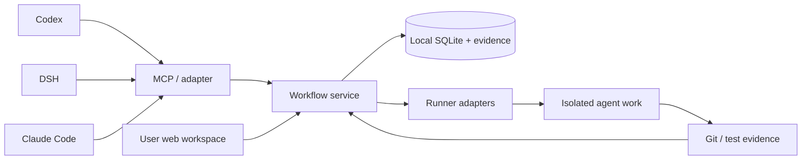

# agileDev_Collabrotion

A workflow plugin for one person or a small team developing with multiple agents across Codex, DeepSeek Harness (DSH), and Claude Code.

The product combines a visual web workspace for people with a compact tool interface for agents. Requirements, approved designs, delegated work, reviews, independent QA, user acceptance, and Git evidence form one traceable record.

**Current delivery: planning only, 2026-11-04.** There is no application, installable plugin, running service, or verified harness integration yet. Specification version **0.1 is proposed for user review**. Publishing these documents does not approve the product design or authorize its implementation phase.

## Read the plan

| Document | Purpose |
| --- | --- |
| [Product specification](docs/product-spec.md) | Scope, requirements, decisions needing review, and requirement traceability |
| [Workflow specification](docs/workflow.md) | States, permissions, rejection loops, approvals, parent completion, and closure rules |
| [Architecture](docs/architecture.md) | Components, storage, identity, concurrency, recovery, Git, and future sharing |
| [Agent contract](docs/agent-contract.md) | Proposed tools, compact work packets, role behavior, and harness adapters |
| [Research](docs/research.md) | Primary sources, compatibility evidence, alternatives, and unresolved feasibility questions |
| [Delivery plan](docs/delivery-plan.md) | Phase boundaries, seed backlog, dependencies, and release gates |
| [Acceptance catalogue](docs/acceptance.md) | Executable acceptance scenarios and the evidence each phase must produce |

Start with the decisions in the product specification, then review the workflow and phase gates. State transitions are authoritative in `docs/workflow.md`; the other documents reference them.

## Intended experience

1. The product lead discusses a requirement with the user, writes a design, and requests approval of that exact revision.
2. PM prepares child issues, acceptance coverage, dependencies, and assignments; unapproved work can remain unstarted and unassigned.
3. Workers claim isolated assignments and submit implementation evidence.
4. The lead performs an initial review, an independent QA run tests the result, and the lead performs a final review.
5. The user accepts the reviewed result. Git-backed work requires its final immutable commit link before completion.
6. The parent completes after the child and integration conditions defined in the workflow are satisfied.

## Delivery boundaries

- P0: research and reviewable specifications — this repository snapshot.
- P1: feasibility spikes for all three harnesses and Windows packaging.
- P2: workflow engine, persistence, permissions, and audit history.
- P3: web workspace and MCP tools connected to the same engine.
- P4: dispatch, concurrent work, independent QA, and Git closure evidence.
- P5: packaged three-harness MVP and end-to-end acceptance.
- P6: shared hosting and additional team features, separately scoped later.

The MVP includes P1–P5. A connected MCP tool alone is not the complete multi-agent product.

## Repository policy

The repository name intentionally preserves the requested directory name. The proposed runtime/plugin identifier is `agiledev-collaboration`, subject to package-name availability checks in P1.

Only product source, documentation, and deliberately sanitized fixtures belong in this public repository. Workspace contents, issue databases, run logs, credentials, and private project evidence remain local by default. There is no automatic upload of tracked projects to this repository.

No software license has been selected yet. Public visibility does not itself grant a software license; choose one before distributing runtime packages.
