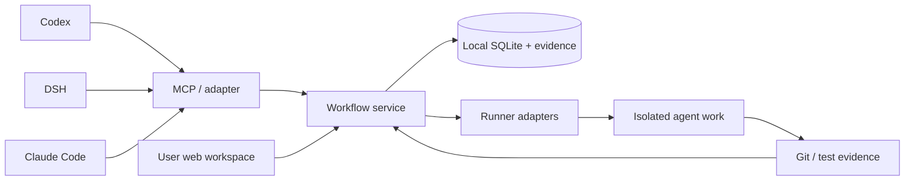

# agileDev_Collabrotion

A local collaboration application for one person or a small team developing with multiple agents across Codex, DeepSeek Harness (DSH), and Claude Code.

The product combines a visual workspace for people with a compact MCP interface for agents. The approved delivery direction is a desktop application with browser fallback. A Windows x64 portable test package and an owner-managed shared service now exist; desktop lifecycle and full release acceptance remain pending. Native harness plugins are optional shortcuts. Requirements, approved designs, delegated work, reviews, independent QA, user acceptance, and Git evidence form one traceable record.

**Current delivery: implementation in progress, 2026-11-09.** A local SQLite workflow service, scoped CLI/MCP entry, atomic PM planning/coverage, native dispatch coordinator, independent QA, assembled parent acceptance, Git verification, and a responsive human web workspace now exist. The complete P1–P5 MVP is not finished.

Verified: 82 automated tests cover workflow, shared MCP state, real Git isolation/test subprocesses, independent QA/rework, Git closure/retry, human sessions/grants, atomic PM decomposition, human scope decisions, criterion coverage, aggregate dependencies, exact managed-worker binding, legacy recovery, concurrent owner startup, explicit process-loss recovery, guarded shutdown, generated-configuration discovery/reconnection, and desktop permission/link policies. A two-child integration fixture exercises real Node QA failure, fresh rework, parent acceptance, and reopening through a separate MCP bridge. Browser checks cover desktop/mobile planning, scope decisions, conflicts/retries, integration evidence, execution recovery, Chinese/English settings, persistent zoom, and adaptive layouts. The enabled in-app Browser Use verifies recovery and display settings against the actual service. Model adapters and human decisions in those fixtures are automated setup. A fresh portable package passes generated-configuration connection checks in all three actual hosts before/after explicit owner restart; Codex exercises list/create/get, while Claude/DSH establish MCP initialization. Each host's graceful exit preserves the owner-started daemon and observer access. A fresh Claude Code 2.1.317 worker still fails with `Not logged in`. A fresh package also passes an author-run native close/reopen drill in which the owner-started service survives the desktop; independent source review passes, while independent native lifecycle revalidation remains pending. Desktop interaction, installation/update/removal, release packaging acceptance, reparenting, risk waivers, batch decisions, Git normalization, and full release acceptance remain unfinished.

The 2026-11-09 real Codex 0.167.0-alpha.3.2 to DSH 0.2.2-rc.1 worker/QA handoff passes the strict execution-binding rules: separate sessions/directories, a sealed two-file artifact, and 14 actual Node checks including negative controls. Its human/design/lead decisions are automated fixture setup. Native-model parent integration, Git publication/closure, and full three-harness execution are separate remaining release scenarios.

To use the web workspace locally, build, run `node dist/cli.js serve`, then run `node dist/cli.js ui` in another terminal. Open the printed loopback URL and enter its one-use pairing code. Do not place the code or owner credential in a URL. The service keeps human browser sessions separate from agent credentials.

`npm run desktop` builds and opens the desktop shell, starting or reusing the local service. For headless operation, the owner runs `node dist/cli.js service-start` first. Configured MCP clients silently attach to that service with explicit scoped credentials; they never start a persistent service from inside a harness. An offline bridge returns `SERVICE_OWNER_START_REQUIRED`. `npm run package:desktop` compiles current sources into fresh private staging and builds a portable Windows x64 directory, recording its path/checksum in ignored `release/latest.json`. The package includes Node, its license, the service, and production dependencies. Use `node dist/cli.js stop` for owner-authorized shutdown. Desktop/window closing is distinct from stopping the shared service. Controlled native exit/reopen still needs revalidation; the test package is not a signed or accepted release.

Settings includes Chinese/English interface selection and 50–200% page zoom. Ctrl/Command + mouse wheel changes zoom; the wheel otherwise scrolls normally. Ctrl/Command + 0 or the reset button restores 100%. Preferences persist locally and sync across same-origin tabs. Requirement text, evidence, and workflow data retain their original values.

See [local setup and commands](docs/local-development.md) for the executable slice and [current implementation evidence](docs/implementation-status.md) for limitations and remaining gates. The older specification documents define the target; their proposed features must not be mistaken for implemented behavior.

## Read the plan

| Document | Purpose |
| --- | --- |
| [Product specification](docs/product-spec.md) | Scope, requirements, decisions needing review, and requirement traceability |
| [Workflow specification](docs/workflow.md) | States, permissions, rejection loops, approvals, parent completion, and closure rules |
| [Architecture](docs/architecture.md) | Components, storage, identity, concurrency, recovery, Git, and future sharing |
| [Agent contract](docs/agent-contract.md) | Proposed tools, compact work packets, role behavior, and harness adapters |
| [Research](docs/research.md) | Primary sources, compatibility evidence, alternatives, and unresolved feasibility questions |
| [Delivery plan](docs/delivery-plan.md) | Phase boundaries, seed backlog, dependencies, and release gates |
| [Acceptance catalogue](docs/acceptance.md) | Executable acceptance scenarios and the evidence each phase must produce |

Start with the decisions in the product specification, then review the workflow and phase gates. State transitions are authoritative in `docs/workflow.md`; the other documents reference them.

## Intended experience

1. The product lead discusses a requirement with the user, writes a design, and requests approval of that exact revision.
2. PM prepares child issues, acceptance coverage, dependencies, and assignments; unapproved work can remain unstarted and unassigned.
3. Workers claim isolated assignments and submit implementation evidence.
4. The lead performs an initial review, an independent QA run tests the result, and the lead performs a final review.
5. The user accepts the reviewed result. Git-backed work requires its final immutable commit link before completion.
6. The parent completes after the child and integration conditions defined in the workflow are satisfied.

## Delivery boundaries

- P0: research and reviewable specifications — this repository snapshot.
- P1: feasibility spikes for all three harnesses and Windows packaging.
- P2: workflow engine, persistence, permissions, and audit history.
- P3: web workspace and MCP tools connected to the same engine.
- P4: dispatch, concurrent work, independent QA, and Git closure evidence.
- P5: packaged three-harness MVP and end-to-end acceptance.
- P6: shared hosting and additional team features, separately scoped later.

The MVP includes P1–P5. A connected MCP tool alone is not the complete multi-agent product.

## Repository policy

The repository name intentionally preserves the requested directory name. The proposed runtime/plugin identifier is `agiledev-collaboration`, subject to package-name availability checks in P1.

Only product source, documentation, and deliberately sanitized fixtures belong in this public repository. Workspace contents, issue databases, run logs, credentials, and private project evidence remain local by default. There is no automatic upload of tracked projects to this repository.

No software license has been selected yet. Public visibility does not itself grant a software license; choose one before distributing runtime packages.
