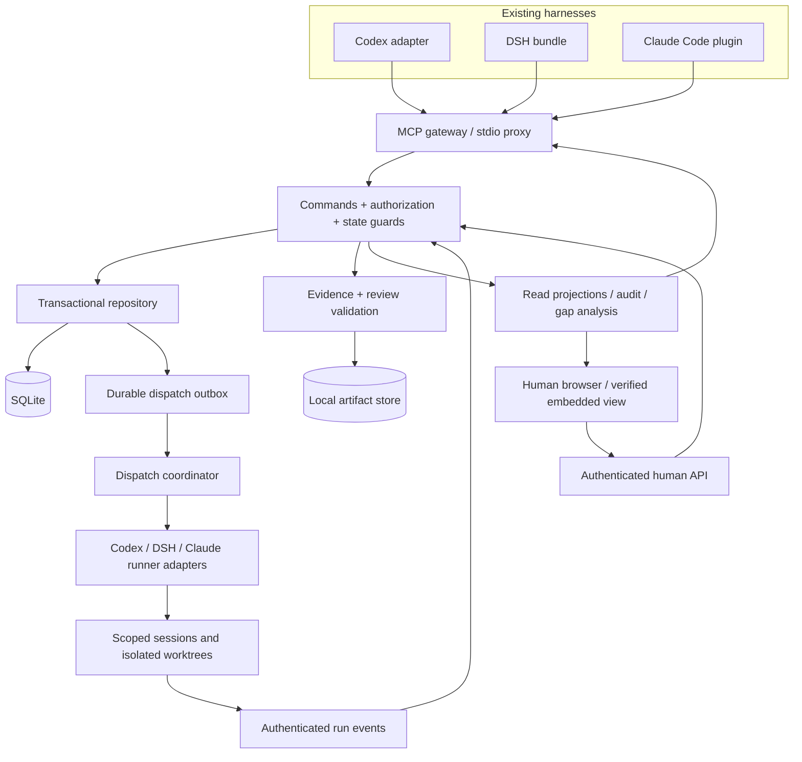

# Proposed architecture 0.1

Status: proposed; implementation choices depend on P1 results. Domain behavior is specified in [workflow.md](workflow.md).

Desktop implementation decision, 2026-11-09: use a pinned Electron shell to host the existing loopback web UI, with a separately bundled Node service/runtime. This preserves the service's native SQLite ABI and existing harness adapters rather than moving workflow code into Electron. No renderer Node integration, privileged preload, or general-purpose IPC is needed. The main process obtains a distinct human browser session through the existing pairing authority; the owner credential stays outside the renderer. Explicit human UI actions remain necessary for every approval.

The desktop and stdio MCP entries share one validated daemon descriptor/lock. A live or uncertain lock blocks a competing writer. Closing the desktop window leaves the service available to harnesses; an explicit owner stop command performs graceful coordinator shutdown. The desktop creates its bounded service bootstrap before Chromium launches helper processes, because Windows children created by Node inherit every inheritable handle and a service holding a Chromium IPC endpoint blocks desktop exit. Version mismatch, malformed metadata, and unavailable startup are errors rather than permission to replace a running service. Portable Windows packaging includes the service's Node runtime and production dependencies; fresh-machine installation, removal/data preservation, and three-host execution remain separate acceptance gates. Native window checks extend AC26/27/30/38; service ownership/reuse/recovery extends AC01/18/29/35/38.

Service ownership correction, 2026-11-09: native Codex acceptance demonstrated that a daemon born under an MCP host can disappear when that host exits, interrupting another connected client. The same native lifecycle preserved a service started independently by its local owner. Persistent startup therefore belongs to the desktop or an explicit local-owner `service-start`, `ui`, or foreground `serve` invocation. MCP bridges, ordinary commands, and connection generation only attach to an already-running service. An absent or crashed service returns `SERVICE_OWNER_START_REQUIRED`, directing the user to open the desktop or explicitly restart the same data directory; no agent-triggered restart, scheduler, or host isolation escape is used. An uncertain live process still requires inspection rather than replacement. Generated local configurations keep `AGILEDEV_DATA_DIR` discovery so a new bridge can attach after an explicit owner restart; explicit endpoints remain pinned and require an explicit agent credential, never a fallback local owner token. This replaces the earlier MCP auto-start expectation for AC01/18/29/35/38 and P1/P5 lifecycle acceptance. Cross-harness collaboration and all workflow/authorization gates remain required; this amendment does not establish release or full execution acceptance.

## 1. Decisions and alternatives

| Decision | Proposed choice | Reason and consequence |
| --- | --- | --- |
| Workflow authority | One local daemon | All harnesses and the UI see one policy/data store; no direct database writes by adapters |
| Implementation language | TypeScript on Node 24 LTS | Fits MCP, DSH integration, and a shared web type contract; exact versions locked after P1 |
| HTTP service | Fastify candidate with schema-validated commands | Small local service, explicit commands; framework choice can change without changing the domain contract |
| Persistence | SQLite WAL + local content-addressed evidence | Low-operations single-machine deployment; serialize writes and test restore |
| Database driver | `better-sqlite3` candidate | Native Windows binary availability is a P1 gate; avoid changing the data model to accommodate a driver |
| Human UI | React + Vite candidate | Reusable views for browser and embedded host surfaces; business rules remain server-side |
| Agent entry | MCP stdio proxy and Streamable HTTP | Same commands/read projections across Codex, DSH, Claude Code |
| Execution | Host-native delegation where verified; official SDK/App Server adapters for managed runs | Preserve harness identity/permissions; do not replace the harness agent loop |
| Test tools | Vitest candidate + real SQLite integration tests + Playwright UI tests | Exercise domain invariants, recovery, and actual human interactions |
| Cloud/team backend | Deferred; stable IDs and repository interfaces prepared now | P6 can add membership and PostgreSQL without a second workflow policy implementation |

This is a modular monolith, not microservices. No message broker, Kubernetes, external database, or model API is required to operate the issue workflow. Launching agents can incur the user's existing harness/provider costs.

## 2. Components and trust boundaries



Embedded UI transport is a host-specific presentation adapter. It must not acquire human authority merely because the model invoked the tool that opened it. Human approval requires an independently authenticated interaction; otherwise the view links to the browser approval page.

Suggested implementation layout, created only when its phase starts:

```text
apps/service                 daemon, human HTTP API, read events
apps/web                     browser views and reusable review components
packages/domain              state machine, policy, readiness/closure validators
packages/storage             SQLite migrations, repositories, transactional outbox
packages/contracts           versioned command/result and read schemas
packages/mcp                 tool registration, text projections, stdio proxy
packages/runner              scheduler, ownership, event ingestion, recovery
adapters/codex                native package and execution adapter
adapters/claude-code          native package and execution adapter
adapters/dsh                  bundle, client view, execution adapter
```

Avoid empty scaffolding and unnecessary packages in P0/P1. Split only when a real consumer exists.

## 3. Local service lifecycle

The installation stores its database, evidence, daemon metadata, and credentials under an OS user data directory, outside tracked repositories. A project may contain an optional nonsecret binding file, but local credentials and transcripts never belong there.

Use one user-scoped daemon with a validated endpoint descriptor and single-instance lock. A local launcher can start it; stdio clients proxy commands rather than each owning a new SQLite database. If the lock owner cannot be verified, report a recovery condition instead of starting a second writer blindly.

Use a configured/remembered loopback port and stable `/w/{workspace_id}/issues/{issue_id}` routes. IDs do not depend on title, checkout path, or port. A logical `agiledev://workspace/{id}/issue/{id}` URI may be added if OS registration proves reliable; it is not required for baseline links. If the service is unavailable, the browser explains how to restart it. A changed port updates generated links; sharing local links across machines is not promised before P6.

Bind only to loopback in local mode; validate Host/Origin, restrict CORS, protect human sessions with HttpOnly/SameSite cookies and CSRF checks, and authenticate agent APIs separately. Do not use a bearer token embedded in an issue URL. Pair the human browser using a short-lived one-time bootstrap code, then rotate it out of the URL/history.

## 4. Data model

All mutable aggregate roots have an integer `version`; timestamps are server UTC and displayed in the user's timezone. IDs are opaque immutable UUIDs. Display keys use a workspace prefix and transactional monotonically allocated sequence.

| Entity | Important fields / invariants |
| --- | --- |
| Installation | ID, schema version, configured endpoint; one active writer |
| Workspace | ID, display name/prefix, repository identities, ownership policy; not derived solely from remote URL |
| WorkspaceBinding | Host, canonical root, Git common-dir identity, execution root, source/provenance, trusted status; multiple worktrees may map to one workspace |
| Actor | Human/agent/service kind, harness/session reference, logical role assignment; no caller-controlled elevation |
| Credential | Hash, actor/run/workspace/issue scope, expiry, revocation; raw token disclosed only when pairing/launching |
| Issue | ID/key, workspace, parent, type, title/suffix, lifecycle, stage, scope revision, owner/assignee, priority/dates, optional effort estimate/confidence, artifact mode, version |
| DesignRevision | Immutable content, content hash, parent requirement, criterion set, supersedes ID; approval references the exact ID/hash |
| TaskScopeRevision | Immutable owned scope, exclusions, mapped criterion IDs, expected outputs, dependency revision |
| AcceptanceCriterion | Stable ID within requirement, revision, required evidence class, integration/task mappings |
| Dependency | Directed `blocks` edge within workspace; no cycles or self-links; related links are not blocking edges |
| Assignment | Issue, role, assignee, scope revision, adapter/binding; changes preserve history |
| Lease | Issue/assignment, owning run, expiry, increasing fence; one active implementation lease per issue |
| Run | Dispatch ID, provider/session ID, role, issue, attempt, state, cwd, base/snapshot, start/end, budget; uncertain is explicit |
| Evidence | Type, content hash, storage reference, producer, criterion map, artifact/design/scope revision, capture metadata |
| Review | Stage, reviewer/run, verdict, criterion results, evidence references, round, acceptance digest |
| Approval / Grant | Human issuer, bound revision/digest, action/scope, expiry/use limit/revocation where applicable |
| Defect | Related task, reproduction, criterion, expected/actual, severity, state, owner; unresolved blocking findings prohibit QA pass |
| ScopeDecision | Exact excluded/replaced child/criteria, human decision, reason, design revision |
| GitDelivery | Repository identity, base/full delivery SHA, canonical URL, artifact manifest, resolution status/time, optional merge/deploy facts |
| AuditEvent | Sequence, actor, command, before/after version, changed fields, reason, evidence/approval IDs, correlation ID |
| CommandReceipt | Actor + operation + idempotency key, input hash, outcome, committed version; reused key with changed input is rejected |
| Outbox / DispatchAttempt | Transactional job intent, dispatch key, lease owner, attempts, provider reconciliation references |

Use foreign keys and unique indexes as well as application validation. Prevent cross-workspace parent/evidence references, duplicate keys, duplicate receipts, and concurrent active leases at the data layer. Event payloads avoid raw secrets/transcripts. Append-only audit is an application guarantee, not protection from a local administrator editing the database.

## 5. Command processing and concurrency

1. Authenticate, resolve server-side actor/role/scope, validate schema and command size.
2. Look up the idempotency receipt scoped to actor and operation. An exact replay returns its original committed result. A changed input under the same key fails.
3. Begin a short write transaction; compare expected versions for the issue and any affected parent/plan.
4. Evaluate current authority, grants, approved revisions, legal transition, readiness, evidence, and parent/dependency invariants.
5. Update records using compare-and-swap, append events, consume grants if used, persist a command receipt, and enqueue any external intent atomically.
6. Commit before performing provider calls or filesystem-intensive work. Deliver UI events from committed event sequences.

No network call runs inside a SQLite write transaction. Long verification reads produce evidence with snapshot/version references; the final transaction rechecks those references. On contention return bounded retryable errors with backoff guidance, not silent last-writer-wins updates.

Default implementation lease: five minutes, renewed every minute; both values are configurable and tested, not a correctness assumption. Each new lease gets a strictly increasing fence. Expired/stolen leases cannot submit or advance issue state. Late logs may be retained as orphan evidence but cannot approve the new round.

Lease expiry does not mean the external process stopped. Before replacement dispatch, reconcile or terminate the old run, or leave the issue blocked as uncertain. Fence tokens protect our state; worktree/process isolation protects the workspace. Never reuse the old directory while its worker may still be active.

Dependency edits and task starts use the same serialized transaction boundary. A new blocking edge cannot be inserted in a way that silently invalidates an active assignment; record a plan amendment and stop/reconcile affected work. Any manual override requires an explicit human scope decision, not a hidden PM force flag.

## 6. Dispatch and recovery

PM schedules only ready work. Default active-run limit is two, with an MVP tested ceiling of four and a separate configurable QA/lead capacity policy. Parent waiting on children consumes no worker slot. Keep control/review work able to progress when implementation slots are full.

Dispatch writes a durable intent first. The adapter starts a child using a unique dispatch identifier and stores the resulting provider run/session reference. If the process starts but acknowledgement is lost, mark the attempt `UNCERTAIN` and query/reconcile before retrying. Exactly-once external execution is not assumed. Where the provider cannot query ownership, require an operator decision or confirmed termination before another run.

The runner capability contract is `probe`, `start`, `observe`, `interrupt`, `reconcile`, with `resume` optional. Each method reports supported/unsupported, typed errors, and provider references. Never translate unsupported resume into a new silent execution. Native delegation can use the same lifecycle records with a host-managed adapter.

After daemon restart, reload dispatch intents, invalidate process-local locks, reconcile running/starting/stopping jobs, and mark unknown ones uncertain. A provider completion event only ends a run. It may submit a candidate report, but only guarded commands advance the business workflow. Duplicate or out-of-order events are deduplicated using provider event IDs or stable run-local sequence keys.

Cost/run policy includes active-run cap, maximum attempt count, configurable elapsed/token budget when measurable, and cancellation behavior. A runtime that cannot report tokens says usage is unknown. No automatic provider/model switch on failure. Repeated reject loops create a gap and ask the lead to revise the plan rather than infinitely spawning workers.

## 7. Workspace identity and access

Resolution order: verified host workspace context → advertised MCP roots when available → explicitly configured launch binding → user selection/registration. A plain process cwd or model-supplied path is a hint requiring validation, not a trusted global workspace inventory.

Normalize absolute paths with filesystem identity, case behavior, realpath/junction handling, and Windows drive/UNC semantics. Validate the resolved path is within the approved root. Git worktrees use the common-dir relationship plus explicit installation/workspace binding; independent clones of the same remote are not automatically collapsed. Nested repositories and multi-root sessions require selection; store which root each issue/run uses.

Do not enumerate unrelated drives, import private session history, or auto-create fake requirements for every directory. Workspace registration is idempotent and partitioned; creating the user's actual requirement supplies the top-level parent. A moved directory is rebound after identity verification; missing roots produce a repair flow instead of duplicate projects.

The API requires an explicit workspace ID on reads and writes, plus a server-validated binding for execution. Returned paths are scoped to the requesting actor. Cross-workspace dependencies are read-only references in MVP, not blocking or mutation authority.

## 8. Evidence and Git integration

Evidence is stored by content hash with immutable metadata. Report attachments are size/type-limited; Markdown/HTML rendering is sanitized. A document URL alone is not a versioned design: capture the reviewed content or a retrievable immutable revision and its hash. Do not automatically fetch arbitrary internal URLs or execute commands embedded in ticket text.

The service can record a test request, but trusted run capture must supply actual execution output/status. User/agent-supplied reports are labeled as such. A claimed test pass without the required runner evidence cannot satisfy an executable QA gate. Criteria such as manual design review have their own evidence class rather than fabricated shell output.

The Git adapter validates configured GitHub repository identity and expected full commit, resolves the canonical provider record, and stores verification evidence. It accepts no credential-bearing URL, arbitrary callback host, or branch-head substitute. Local Git checks and provider checks are distinct; private-repository authentication is scoped and kept out of stored links.

Verification is tied to the reviewed snapshot. After a force-push or inaccessible record, preserve history, mark current verification unavailable, and block new closure where required. GitHub unavailability does not erase a previously valid closed delivery; show the last verification time and current availability separately. A new submitted snapshot invalidates reviews according to the workflow.

Merging/rebasing/squashing that replaces the submitted artifact requires a new delivery snapshot and affected checks before acceptance. Do not silently transfer a QA pass between different artifacts. The parent integration suite verifies the final assembled artifact and captures the exact integration snapshot.

## 9. UI and read projections

Serve browser views and agent summaries from the same read services. An event cursor lets the UI resync after reconnect; use a bounded SSE stream or polling fallback. This UI stream is separate from MCP transport/session handling.

Primary views: workspace overview; requirement tree with coverage; backlog/list/board; issue details with role-aware actions; design diff/approval; review/acceptance evidence; run queue; gaps. Show the two lead-review stages, current owner/next action, and waiting reason explicitly.

Gap rules are deterministic and explainable: missing/ambiguous criteria, unmapped approved scope, unassigned or advisory-unscheduled tasks, dependency cycle/block, stale approvals, invalid/expired leases, uncertain runs, missing QA/commit evidence, and repeated rejects. Metrics derive from committed transitions: current WIP, state age, blocked age, queue time, cycle time, rejection rounds, and criterion coverage. Do not present agent task counts or estimates as measured productivity.

Agent results include concise fields, legal next actions, and reason codes. Default brief/list payload budgets are specified in NF05; long reports are retrieved by ID/pagination rather than appended to every response.

### Human interaction design

| Surface | Required content and behavior |
| --- | --- |
| Workspace overview | Active requirements, next-action owners, approval queue, WIP/waiting counts, scope/evidence gaps; each number drills into its records |
| Backlog and requirement tree | Parent/child grouping, criteria coverage, assignee/priority/date/dependency filters; drafts and unassigned work remain visible |
| Board | Group columns into backlog, development/rework, lead review, QA, user acceptance, terminal; cards retain exact state and lead-review stage; hold is an explicit filter/badge |
| Issue detail | Persistent key/link/title and state; requirement/task content; evidence/reviews; assignment/dependencies; chronological decisions; next legal action with blockers |
| Design review | Exact revision and diff, goals/non-goals, criteria, unresolved questions, approve/request-changes; no generic approval detached from a revision |
| Delivery acceptance | Exact snapshot/commit, criterion results, QA defects/waivers, final lead verdict, current blockers, accept/reject; batch selection lists every bound digest |
| Run queue | Queued/running/stopping/uncertain states, owning issue/worktree, budget when known, last event/heartbeat, interrupt/recovery actions |
| Gap panel | Blocking versus advisory groups with cause, age, responsible role, issue/criterion link, and action; no unexplained red score |

Use a left workspace/navigation rail, central tree/list/board, and a detail drawer that can open as a stable full page. The embedded overview is a smaller view of those components; approval can open the full authenticated page when host attribution or screen size requires it. On mobile, use a single-column list/detail flow. Preserve readable evidence and primary actions before decorative charts.

Dragging a board card proposes the corresponding legal command; it never patches a raw state field. Disable unavailable actions with a readable reason and route the user to the missing input. Server conflicts reload current data and show the competing change rather than pretending the drag succeeded.

Explicit UI states include first-run pairing, no workspace, no issues, unresolved root, service disconnected, unsaved design, awaiting human, stale acceptance, closure blocked, and uncertain execution. Show successful human acceptance separately from still-blocked closure. Do not display a success notification before the relevant command commits.

Coverage is shown as approved criteria mapped/passed, with scope exclusions separately counted. An issue-count completion percentage is labeled as counts and never presented as percent of engineering effort or requirement correctness. Planned dates/effort estimates remain optional forecasts; overdue and missing-schedule gaps are advisory unless a user-approved policy says otherwise.

## 10. Backup, migration, and future sharing

Create consistent SQLite snapshots through supported backup facilities. Include a schema/version manifest and all referenced evidence hashes. Restore into a separate directory, verify counts/hashes/relationships, then explicitly switch installations. JSON/Markdown export is useful for inspection but is not the only recovery mechanism.

Migrations have versioned steps, a pre-migration backup, and failure recovery. Do not promise downgrade through an incompatible schema; restore the backup with its matching runtime. Data-retention/deletion UX is deferred, so MVP does not silently purge audit/evidence.

P6 should first add authenticated multi-human membership and a server authority with local runner companions. Agents on other machines must not open the SQLite file over a network share. Introduce PostgreSQL when shared write/hosting requirements justify it; preserve IDs, command semantics, revision approval, and audit causality. GitHub/Jira/Linear projections need field ownership, conflict resolution, and outbox/inbox deduplication before two-way sync is enabled.
