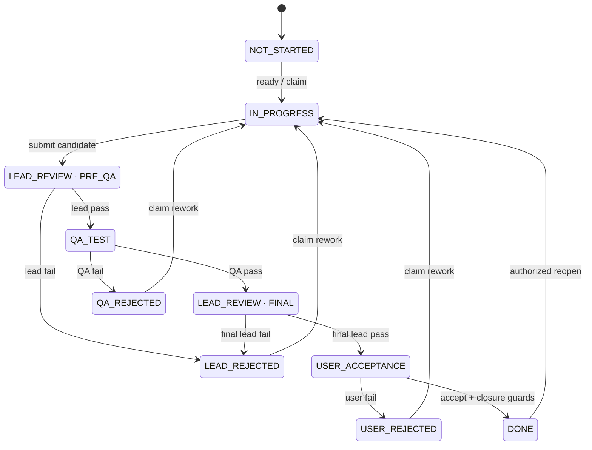

# Workflow specification 0.1

Status: proposed. This document is the canonical state, permission, approval, and completion contract. It implements the requirements in [product-spec.md](product-spec.md); D03–D07 remain reviewable policy choices.

## 1. Separate four kinds of state

| Dimension | Values / meaning |
| --- | --- |
| Issue lifecycle | Work and review progress; listed below |
| Design revision | `DRAFT`, `IN_REVIEW`, `APPROVED`, `CHANGES_REQUESTED`, `SUPERSEDED` |
| Run lifecycle | `QUEUED`, `STARTING`, `RUNNING`, `STOPPING`, `SUCCEEDED`, `FAILED`, `CANCELLED`, `UNCERTAIN` |
| Evidence/approval validity | Current, superseded, incomplete, unavailable, or invalidated at a recorded revision |

A draft issue is still `NOT_STARTED`. A running process does not prove an issue is `IN_PROGRESS`, and a successful process does not prove the issue is implemented. An issue in `QA_TEST` can have a queued QA run. Keep those facts visible without adding dozens of issue states.

## 2. Issue states

| Code | Display meaning | Additional data |
| --- | --- | --- |
| `NOT_STARTED` | Not started | May be unassigned, unscheduled, and waiting for design approval |
| `IN_PROGRESS` | Development in progress | Current assignment, run binding, lease/fence, and approved scope revision |
| `LEAD_REVIEW` | Main/product agent review | `review_stage` is required: `PRE_QA` or `FINAL` |
| `LEAD_REJECTED` | Rejected by main/product agent | Required rejection record, stage, failed criteria, and responsible assignment |
| `QA_TEST` | Independent QA | Required candidate snapshot and QA assignment/request |
| `QA_REJECTED` | Tests failed | Required QA report and blocking defect/failure references |
| `USER_ACCEPTANCE` | User acceptance | Final lead report and exact delivery snapshot |
| `USER_REJECTED` | User requested rework | Required user decision with a classification (`DEFECT`, `SCOPE_CHANGE`, or `CLARIFICATION`) and the related defects, failed criteria, or clarification |
| `ON_HOLD` | Suspended | Reason, authorizing decision, previous state/stage, affected runs, optional review date |
| `ABANDONED` | Abandoned | Terminal non-delivery outcome; reason, authorization, and scope disposition |
| `DONE` | Implemented and closed | Terminal successful delivery; current approvals, evidence, and closure event |

Do not introduce a second `CLOSED` state that bypasses `DONE` validation. Abandoned is terminal for queueing but never means delivered. Merge and deployment are separate recorded facts.



Hold, resume, abandon, and scope-amendment transitions are defined separately below; they apply across several states and are intentionally omitted from the main diagram.

## 3. Transition contract

All mutations require authenticated actor scope, `expected_version`, and an idempotency key. Every successful transition appends an event in the same database transaction as the issue update. UI, MCP, runners, and later connectors use this contract without bypass routes. Under accepted revision R1, Git/CI/verifier and other event-fact callbacks may record facts, verification, readiness, or reminders, but cannot advance issue lifecycle or create human decisions. This does not prohibit explicit, scoped worker, lead, QA, or human commands from requesting their authorized transitions through the service; a provider exit or fact event alone is not such a command.

| From | Action / actor | To | Required guards and evidence |
| --- | --- | --- | --- |
| No item | Create / human, lead, PM | `NOT_STARTED` | Valid workspace and parent; generated ID/key; never caller-selected active state |
| `NOT_STARTED` | Claim / assigned worker | `IN_PROGRESS` | Approved design, acknowledged task scope/criteria revision, readiness, dependencies, binding, capacity, no hold; atomic lease |
| `IN_PROGRESS` | Submit / owning worker | `LEAD_REVIEW:PRE_QA` | Current lease fence, exact candidate snapshot, criterion map, self-check evidence, handoff summary |
| `LEAD_REVIEW:PRE_QA` | Pass / assigned lead | `QA_TEST` | Current criterion-level initial review; independent QA assignment created or queued |
| `LEAD_REVIEW:PRE_QA` | Fail / assigned lead | `LEAD_REJECTED` | Reproducible rejection reasons and failed/missing criteria |
| `QA_TEST` | Pass / assigned QA | `LEAD_REVIEW:FINAL` | Independent run/session, exact candidate, complete required tests, no unresolved blocking findings |
| `QA_TEST` | Fail / assigned QA | `QA_REJECTED` | Failure report with expected/actual behavior, reproduction, severity, criterion, and artifact |
| `LEAD_REVIEW:FINAL` | Pass / assigned lead | `USER_ACCEPTANCE` | Initial review + QA still current; requirement fit and integration implications assessed |
| `LEAD_REVIEW:FINAL` | Fail / assigned lead | `LEAD_REJECTED` | Recorded final-stage rejection; rework owner retained or explicitly reassigned |
| `USER_ACCEPTANCE` | Reject / human | `USER_REJECTED` | Exact snapshot/revision and actionable feedback; classification `DEFECT` (creates defects on the rejected digest), `SCOPE_CHANGE` (rework blocked by `SCOPE_REVISION_REQUIRED` until a newer approved design), or `CLARIFICATION` |
| `USER_ACCEPTANCE` | Accept / human | `DONE` when guards pass | Human decision bound to current acceptance digest; optional MINOR waivers in the same transaction; batch acceptance per §5; all closure checks pass |
| `USER_ACCEPTANCE` | Complete / lead or PM | `DONE` | Exact-snapshot human close grant or prior current human acceptance; all closure checks still pass |
| Any rework state | Claim rework / assigned worker | `IN_PROGRESS` | Valid assignment/binding, dependencies, fresh lease, required approved scope |
| Nonterminal state | Hold / human or granted lead/PM | `ON_HOLD` | Reason, action scope, prior state/stage saved; cancellation/reconciliation of active runs requested |
| `ON_HOLD` | Resume / human or granted lead/PM | Saved valid state or `IN_PROGRESS` | Revalidate revision, evidence, dependencies, and ownership; never restore an expired lease |
| Nonterminal state | Abandon / human or granted lead/PM | `ABANDONED` | Reason, authority, explicit child disposition and scope impact; stop/reconcile live work |
| `DONE` or `ABANDONED` | Reopen / human or specifically granted lead/PM | `IN_PROGRESS` or `NOT_STARTED` | Reason, affected parent reopened atomically, prior closure preserved, invalidated approvals identified |

On reopen, use `IN_PROGRESS` only when a ready assignment is actually claimed. Otherwise use `NOT_STARTED` and require a normal claim. If an issue returns from a review stage for implementation changes, its next submission always starts at `PRE_QA`.

Human acceptance is an immutable decision record. If the human accepts while Git verification is unavailable, save the decision and leave the issue in `USER_ACCEPTANCE`. Recovery or `git_retry` changes verification/readiness only. The accepted issue remains visible and actionable until an explicit authorized `delivery_complete` validates the unchanged acceptance and all current guards; no invented second approval is required. An explicit human acceptance command, including a valid batch, may close an item whose guards already pass in that same transaction. Never display `DONE` before the authorized closure transaction commits.

## 4. Permission model

| Capability | Human | Product lead | PM | Worker | QA |
| --- | --- | --- | --- | --- | --- |
| Read authorized workspace records | Yes | Yes | Yes | Assigned scope | Assigned review scope |
| Create parent / task drafts | Yes | Yes | Yes | Propose only | Defect proposal/report |
| Edit unapproved designs | Yes | Owned design | Draft decomposition | Propose changes | Propose changes |
| Approve design or material scope change | Yes | No | No | No | No |
| Plan tasks, dependencies, dates, iterations, assignees | Yes | Yes | Yes | No | No |
| Dispatch implementation | Approved policy | Coordinate | Yes | No | No |
| Claim / submit implementation | Through worker assignment | Only if separately assigned worker | Only if separately assigned worker | Own assignment | No |
| Initial / final lead review | Can perform explicitly as reviewer | Assigned reviewer | No | No | No |
| QA report and pass/fail | Separate reviewer context | No self-QA | No | No self-QA | Assigned independent review |
| User acceptance | Yes | Exact human grant only | Exact human grant only | No | No |
| Propose a defect | Report directly | Within read scope | Within read scope | Within read scope | Within read scope |
| Triage defects, waive MINOR defects, batch-accept deliveries | Yes | No | No | No | No |
| Hold / abandon / exceptional close / reopen | Yes, subject to invariants | Scoped human grant | Scoped human grant | No | No |

Human manual entry does not bypass the independent QA or evidence requirements. A person may deliberately assume the QA role, with a separate reviewer record; the result must be labeled human QA rather than attributed to an agent.

Roles are resolved from a server-issued credential/actor binding. Supplying `role: "user"` or a different actor ID in tool arguments never elevates a caller. The MCP agent surface exposes request-for-approval, not human decision or grant creation.

A lead reviewer cannot approve implementation produced by that same execution identity. If the product lead also implements a task, assign a different lead-review execution identity for that task. This is separate from the additional worker/QA independence rule.

## 5. Approval and authorization records

Design approval binds `workspace_id`, `requirement_id`, `design_revision_id`, `content_hash`, human identity, decision, timestamp, and optional explanation. Task execution references that approved revision and its own reviewed scope revision.

Delivery acceptance binds an acceptance digest containing the design revision, task scope revision, artifact manifest hash, lead-review IDs, QA report ID, and verification-policy version. The UI shows those components before the human decides. An old decision is not reusable against a new digest.

A delegation grant contains the granting human, grantee, workspace/item scope, allowed action, exact revision/snapshot where relevant, expiry, maximum uses, and revocation state. Grant use is transactional and audited. A lead/PM cannot delegate beyond its grant. A generic role assignment is not an abandonment, hold, reopen, or closure grant.

Implementation refinement, 2026-11-07: one grant authorizes one named logical lead/PM, one exact issue, and one action (`hold`, `resume`, `abandon`, `reopen`, or `complete`). It never grants direct actions on descendants implicitly; normal ancestor-hold effects still apply. It binds the applicable design and a hash of the issue/child scope, lasts at most seven days, and permits one to ten uses. Creation compares the hash displayed to the human, including child-scope changes that do not alter the parent's metadata version. A material scope change invalidates the grant; title/date/priority edits do not. Creation and revocation require the authenticated human channel. Agents may list their grants and provide a `grantId` to the existing guarded command. Failed transitions and stale-version requests consume no use; exact idempotent retries cannot consume twice.

A completion grant additionally binds the currently reviewed candidate and delivery digest. Its human confirmation must expose the same requirement/review/manifest/commit packet as delivery acceptance. Successful delegated closure records the original human authorization and the executing agent separately. It cannot approve design, supply missing QA, ignore child disposition, or bypass Git/defect/closure guards. A blocked delegated close rolls back its use and acceptance record; an expired or revoked unused grant cannot later close through a provider callback. A previously completed authorized decision remains historical evidence after revocation.

For MVP, human decisions/grants originate in the authenticated web approval flow. A host adapter may later accept direct human events only after AC14 proves attribution; a model's statement that the user agreed is never such an event. Batch decisions enumerate exact item versions/digests; no hidden approval of unseen items is allowed.

### Decision inbox and batch acceptance, 2026-11-09

Accepted revision R1 (D11, D13, D14): the service derives the human decision inbox from current records. It lists designs `IN_REVIEW`, deliveries needing a current valid decision on the digest and applicable decision defect set, unresolved abandoned-child scope, uncertain/legacy-unbound execution, accepted deliveries still in `USER_ACCEPTANCE`, and defect proposals. Entries bind exact versions and revision hashes/digests. The existing `CLOSURE_BLOCKED` kind covers both guard-blocked and `READY_TO_COMPLETE` accepted deliveries: expose named blockers or an authorized `delivery_complete` action, and retain the entry until explicit completion. There is no separate mutable queue and no agent create/dismiss/resolve operation. `pendingSince` is the first unresolved pending event for that exact decision target; retries, reads, metadata edits, and guard recovery do not reset it. A genuinely replaced target or a completed-and-reopened decision cycle starts a new pending epoch. The default 24-hour workspace threshold produces `HUMAN_DECISION_AGING`.

Batch delivery acceptance holds 2 to 20 items from one workspace. Every confirmation provides readable expansion of the exact requirement/design and scope, complete file manifest, PRE_QA/QA/FINAL reviews, criterion/check evidence, current versioned defect set and waiver status, Git mapping/verification facts, and parent integration manifest where applicable. Opaque IDs/digests alone are insufficient. Input binds each issue version, candidate, digest, and decision defect-set revision/hash. Validate all targets and evidence preconditions before writing any decision: a stale item or defect set rejects the entire batch with no acceptance saved and input retained. A valid batch saves every per-item immutable acceptance in one transaction even if some Git closure guards remain blocked; guard-ready items may close under that explicit human command. Later fact recovery cannot close remaining items; use explicit authorized `delivery_complete` without another approval if evidence is unchanged. Existing authority, dependency, hold, child, execution, and defect guards remain. Items needing MINOR waivers, design approvals, and rejections stay individual.

Attention signals (inbox count, window title, taskbar flash and overlay, and operating-system notifications where verified) only open the decision view; none can decide. A signal shows kind, workspace, and key unless the human enables titles, and signals exist only while the desktop runs. See [revision R1 §3](proposals/r1-inbox-iterations-defects.md#3-part-a-human-decision-inbox-and-attention-signals).

### Local human web session, 2026-11-06

Implementation refinement for FR14/FR16/FR24 and AC04/05/14/26/27/36: the owner runs `agiledev ui` against the local daemon to obtain a one-use pairing code with a five-minute lifetime. The code is entered on the same-origin login page, never in a URL. Owner API credentials are not included in HTML, assets, browser storage, or agent connection configuration. An agent credential cannot create a human pairing code.

Pairing creates a distinct human browser actor/session, an eight-hour HttpOnly SameSite=Strict cookie, and a session-bound CSRF value held in JavaScript memory. Browser writes require the exact local Origin plus that CSRF value. Logout revokes the session. Pairing/expiry/reuse and authentication failures cannot create approvals. The local HTTP boundary still cannot isolate a hostile process running as the same OS user.

The web workspace reads bounded projections from the shared service and uses the same versioned commands for every mutation. It shows the exact design revision/hash or delivery digest before a reasoned human decision. A stale dialog must fail rather than silently approve new content. Polling checks committed workspace cursors at one-second intervals; reconnection reloads current records without an optimistic invented transition. History and evidence remain scoped and paginated; user content is rendered as text, never executable HTML.

Working visual direction: a true-white issue workspace with a pale cool sidebar, indigo controls, an open hierarchical list/board, and a right inspector. The inspector becomes a drill-in page on narrow screens. Shared tokens: canvas `#ffffff`, sidebar `#f2f5fa`, text `#10122b`, muted `#626b7a`, rule `#dce1ea`, accent `#342df4`, selected `#edebff`, 8px control radius, 8px spacing scale, 14px body/control text, and visible keyboard focus. Screens include Backlog, Board, Reviews, Runs, Settings, issue overview/design/evidence/activity, and explicit decision dialogs. Generated concepts are implementation references, not user product-design approval or runtime evidence. Domain labels and real data take precedence over illustrative fixture copy.

### Managed implementation binding, 2026-11-09

Implementation claim, heartbeat, and submission require a server-issued execution actor bound to one implementation run, logical assignee, harness, workspace, approved design, task scope, and isolated execution directory. A logical worker credential alone cannot claim or submit from the source checkout. The coordinator claims only its reserved `STARTING` run; heartbeat/submission require that exact run to be `RUNNING`. Submission additionally requires the provider's recorded session identity. Queued, stopping, uncertain, terminal, mismatched, duplicate-live, or unbound executions cannot acquire or extend ownership. Expired leases still require reconciliation rather than renewal or silent replacement.

Old unbound leases/candidates remain readable but cannot advance review or delivery. The human-only `work_reconcile` command binds the exact issue version, fence, and candidate ID, requires explicit confirmation that the old external worker stopped, and records a reason. It rejects completed issues and known live/uncertain task or parent integration runs; those use normal run reconciliation instead. Resetting preserves old candidate/evidence records, clears current ownership and reviews, advances the fence, invalidates affected parent integration, and preserves effective holds or abandonment. This acknowledges the human's external stop confirmation; it does not fabricate provider identity or OS-level proof for an untracked process. An unchanged requirement can then be dispatched normally through any supported adapter. This command is absent from MCP. Existing historical completion records are not rewritten by startup or migration.

Acceptance impact: AC09/14/16/17/20/24/35 additionally exercise principal-credential rejection, exact run binding for every worker command, no source-root fallback, stale/uncertain execution denial, recorded-provider submission, and explicit human recovery of development-era unbound records. Provider test doubles are distinguished from actual native execution.

## 6. Revision changes and rework

1. Requirement scope/acceptance edits create a new design revision. The approved old revision remains in history.
2. A material revision enters review, blocks new affected claims, and requests active affected runs to stop or reconcile. Unaffected completed requirements stay intact.
3. Existing task mappings, approvals, and reports remain readable but are marked stale where affected. PM proposes revised task coverage.
4. A worker replaces a candidate by opening a new implementation round. Initial review, QA, final review, and human acceptance for the old candidate cannot authorize the new one.
5. Metadata-only edits such as schedule, iteration membership, or assignee display corrections do not invalidate artifact approval. The service categorizes allowed metadata fields; callers cannot assert that a scope edit is metadata.

Implementation refinement, 2026-11-07: design hashes bind the immutable requirement description as well as design content, criteria, delivery mode, and repository binding. Editing a top-level requirement description creates a fresh draft design and invalidates affected child execution/review evidence. Active or uncertain child runs must first be reconciled. The review view shows that captured requirement scope alongside the proposed design. Older revisions without captured scope remain historical evidence, but cannot authorize new execution or a new current approval until a scope-bound revision is reviewed. A hold remains effective while scope is edited or a child is added; editing is not an implicit resume. Run output and heartbeat observations do not change the state version used to request interruption.

An unrelated commit elsewhere in the repository does not rewrite a historical delivery record. Evidence invalidation follows changed issue submissions/scope and explicit impact analysis. Parent integration tests check the assembled result at its current integration snapshot.

## 7. Defects and QA independence

The worker's self-test is useful evidence, but cannot satisfy independent QA. A QA assignment has a different execution/session ID, QA-scoped credential, clean worktree or immutable artifact, approved requirement, and relevant implementation evidence. It does not inherit the worker's full reasoning transcript by default.

QA derives checks from acceptance criteria, tests negative/boundary behavior where relevant, and records `PASS`, `FAIL`, `BLOCKED`, or `NOT_RUN` for every required criterion/check. Blocked and not-run are not passes. A trusted runner records command, exit status, timestamps, environment/snapshot, and report artifact hashes; the QA conclusion adds interpretation.

Blocking findings create linked defects with reproduction steps, expected/actual behavior, criterion IDs, severity, and owner. Severity codes: `BLOCKER`, `MAJOR`, `MINOR`, `INFO`. Unresolved BLOCKER/MAJOR findings block QA pass. Accepting a MINOR residual risk requires an explicit human waiver attached to that delivery digest. Waivers cannot excuse untested mandatory criteria or missing human design approval.

Rework may stay within the original task; a related defect is a tracking record, not permission to ignore the task's acceptance criteria. A changed requirement goes through scope approval. Reject loops keep round numbers and reports so repeated failures are visible.

### Local execution protocol, 2026-11-06

Implementation refinement for FR11/FR12 and AC11/12/19/20/23: managed submission seals a complete delivery after the producer stops successfully. For Git, the manifest includes existing tracked files, nonignored untracked files, and explicitly submitted paths within the registered workspace root. Deleted files are absent. For non-Git delivery, regular source files are captured recursively. `.git`, dependency/service directories, `.qa`, environment files, symlinks, and submodules cannot be delivery artifacts. The private snapshot stores content hashes, sizes, and Git modes and is revalidated before review and acceptance. The copy, rather than a producer's later edits, is the reviewed delivery. Snapshot limits are configurable; large-workspace performance is still unverified.

The human creates an immutable check profile with an absolute native executable, fixed arguments, timeout, and covered criteria. Lead/PM selects an independent QA actor, harness, and approved profiles. Initial lead pass queues QA when configured; otherwise the issue waits at `QA_TEST`. Every QA run gets a new scoped credential/session and a separate snapshot copy, approved design, and handoff summary. No worker transcript is passed.

QA authors tests under `.qa`, queues `qa_check_run`, reads `qa_check_get`, and submits `qa_report_submit` with all criteria, captured check IDs, and reproducible findings. The service, not the model's shell-output claim, records process metadata, command/arguments, exit code, bounded output, timestamps, test-source hashes, and candidate/snapshot identity. Check processes receive a minimal environment without service/provider tokens. This is trusted local test execution under the same OS user, not hostile-code isolation.

The report cannot advance the issue until the native QA producer has stopped successfully and the evidence is revalidated. `PASS` advances to final lead review; `FAIL` creates assigned defects and enters `QA_REJECTED`; `BLOCKED` or `NOT_RUN` cannot pass. The W2b compatibility path resolves prior open QA-origin defects for the same task after a fresh successful QA round, retaining old reports and failure evidence. It never implicitly resolves human-origin confirmed problems; explicit defect verification remains the W3b target below. Narrative `review_submit` cannot pass or fail the QA gate. Lost check execution stays uncertain and consumes check capacity until explicit recovery; recorded live test PIDs block operator reconciliation.

Final lead pass exposes an exact delivery digest. Human `delivery_decide` can accept/reject only that digest. Reviewed artifact mode can close after all guards; Git mode retains acceptance with closure blocked until remote commit verification matches that snapshot. These commands refine the existing gates and do not waive Git, parent integration, UI/human attribution, minor-risk waiver, or release acceptance requirements. The present implementation is stricter than the target waiver policy: any non-INFO current QA finding prevents a pass.

### Defect register, verification, and waivers, 2026-11-09

Accepted revision R1 (D11, D15, D16) makes defects register records with a workspace-local key, origin (`QA`, `USER_ACCEPTANCE`, or `ESCAPED`), severity, criterion IDs, reproduction, expected and actual behavior, the observed snapshot or digest, reporter, owner, and source record. Their states are `PROPOSED`, `OPEN`, `RESOLVED`, `WAIVED`, `REJECTED`, `WITHDRAWN`, and proposal-only `CONVERTED`.

User clarification, 2026-11-11: the three origins describe confirmed defects. An agent may report a pending problem on any readable issue; it starts `PROPOSED` with `origin: null` and a truthful snapshot/delivery observation, or an explicit unsealed issue-scope observation with null snapshot/digest. It is non-blocking and absent from confirmed defect sets. Human rejection or conversion to a linked unstarted requirement records `REJECTED` or proposal-only `CONVERTED`, not QA resolution. Human confirmation requires exact current issue/defect versions and valid immutable evidence in an actual user-acceptance or closed-delivery context; QA origin requires a QA report. Preserve the original observation and record the later confirmation separately. Do not invent an artifact, confirmed origin, approval, or reopening of an unstarted issue.

- QA findings create `OPEN` defects as before. A user rejection classified `DEFECT` creates `OPEN` defects on the rejected digest.
- A defect found after closure references the `DONE` issue and its historical digest without rewriting it. A human may report one directly; any agent may propose one on an issue it can already read. Human triage accepts a proposal with `REOPEN`, `NEW_REQUIREMENT`, or `DEFER`, or rejects it with a reason.
- Every QA packet/report binds the complete required defect-set snapshot, with sorted defect IDs/versions plus a revision/hash detecting additions and removals. It contains every `OPEN` defect and every `WAIVED` defect whose waiver is stale. Each needs an explicit `FIXED`, `PRESENT`, `BLOCKED`, or `NOT_RUN` result; omissions reject the report. `PASS` requires all listed BLOCKER/MAJOR defects fixed. Only a completed `PASS` resolves the named `FIXED` defects; `FAIL` changes no defect state.
- New BLOCKER/MAJOR findings require `FAIL`. MINOR findings may accompany `PASS`, but closure still requires fixing or waiving every open MINOR defect. Human acceptance, waiver, and batch previews bind the complete confirmed decision defect set: `OPEN` and `WAIVED` records, including valid waivers, with sorted IDs/versions and a revision/hash. Untriaged `PROPOSED` records cannot acquire blocking authority; triage that confirms one changes the set. Only a human may waive during `USER_ACCEPTANCE` with a reason, the current artifact digest, and exact defect/set preconditions.
- Lead and PM cannot resolve, waive, reject, or change the severity of a QA-origin defect. Triage, waivers, withdrawal, and rejection classification are human-only and absent from MCP and grants.

The service versions the required and decision defect-set projections per issue and hashes their complete canonical sorted IDs/versions. It updates affected set revisions/hashes in the same transaction as relevant confirmed defect additions/removals or version changes; a proposal alone is not confirmed-set membership. The full frozen set is paginated by reference within the packet budget, not silently truncated.

New confirmed defects or changes to a relevant defect's membership, version, severity, state, verification content, or waiver validity stale affected current QA packets/reports and decision/waiver/batch previews. A new MAJOR during QA requires a fresh required-set packet; a new MINOR during batch confirmation rejects the stale batch; a changed defect after waiver preview rejects that waiver. Set validation occurs against the pre-transaction state. A report may then atomically create its own findings and resolve its verified fixes, recording input and resulting sets; an acceptance/waiver may atomically record its authorized waiver and resulting defect version/set. Those same-transaction effects do not invalidate their own report or decision. Record both expected and resulting defect versions for a waiver, so its own `OPEN` to `WAIVED` transition is valid. Later relevant mutations require fresh affected evidence; closure checks the current decision set, each waiver's covered resulting defect version, and the artifact digest. Staleness is a guard/readiness fact, never an implicit lifecycle transition.

A human waiver of a MINOR already explicitly covered by current QA is a disposition overlay, not a claim that QA found it FIXED. Its authorized state/version change alone does not invalidate that unchanged QA report. Record the input/result-set derivation and retain the original report. Multiple waivers in one decision, or a later authorized waiver of another already-known MINOR, must not invalidate each other solely through those disposition changes. A waiver's covered defect version/digest remain its validity identity; its whole-set preview precondition and recorded resulting set provide concurrency/audit evidence. Unrelated later set changes stale affected decision previews/current closure evidence, not an unchanged waiver merely because another known MINOR was validly waived. This exception permits no severity/reproduction/check-content change, new defect, or waived mandatory criterion.

These new bindings accompany existing artifact digests rather than rewriting digest identities, approvals, grants, reports, or closed history. Apply them to new QA rounds and current decision previews; unmodified pre-R1 closed decisions remain historical, and unchanged pending legacy acceptance uses its original policy until relevant evidence/set changes require refresh. Revision R1 alone causes no blanket retroactive invalidation. Until implemented, the older implicit-resolution and stricter MINOR-pass rules remain current runtime behavior. See [revision R1 §5](proposals/r1-inbox-iterations-defects.md#5-part-c-defect-register).

## 8. Hold, abandon, and interrupted execution

Hold and abandon are business decisions. A failed process, provider limit, lost heartbeat, or unknown execution creates a run problem and a gap; it does not automatically abandon or human-authorize suspension of the issue.

An effective ancestor hold blocks new descendant claims/dispatches immediately. Descendant states are preserved; active descendant runs receive stop requests. `STOPPING`/`UNCERTAIN` remain visible until confirmed. Changing the issue status does not assert that a subprocess stopped.

Abandoning a parent requires a proposed disposition for each unresolved child: abandon with authority, retain/reparent through an approved scope amendment, or reject the parent action. No silent cascade. In-scope child abandonment makes the parent's scope unsatisfied until the user approves exclusion or replacement.

Resume reacquires execution ownership and revalidates evidence. If the saved review snapshot is unchanged and still valid, the review may resume. If implementation is required, resume to unstarted/in-progress with a fresh lease, then repeat the review pipeline.

## 9. Parent completion and reopening

### Versioned decomposition and integration protocol, 2026-11-07

`plan_apply` applies a complete requirement decomposition atomically through the same issue, assignment, dependency, and scope guards as individual commands. It compares the parent, previous plan, and every existing child version; omitted existing children cannot disappear from scope. New task references can depend on other new tasks. Each immutable plan records the design, task scope/dependency bindings, explicit integration-only criteria, overlap reasons, and a content/scope hash. Draft plans may remain incomplete and unassigned. A ready plan requires the current human-approved design, nonempty delivery scope, all required criteria mapped, no unknown criteria or dependency cycles, and explanations for deliberately overlapping ownership. Scheduling and assignment remain optional until a particular task starts.

Aggregate child admission requires a current ready plan; old unplanned drafts need an explicit plan rather than an invented migration approval. A task-scope, dependency, design, or child-set change makes affected plan bindings stale; title/date/priority/assignment edits do not change criterion coverage. An unaffected already-running worker may finish its acknowledged scope while PM amends other draft work. Changed active/uncertain assignments and a live parent integration run must first be stopped/reconciled. New claims/dispatches wait for a current ready plan. This distinction prevents a planning edit from silently approving new scope or discarding unrelated work.

An aggregate waiting in `IN_PROGRESS` without an implementation lease/candidate may receive an integration worker after its in-scope children are complete. Integration captures the exact ready-plan scope and accepted child candidate/snapshot/digest/Git references. The integration worker produces a separately sealed assembled snapshot; initial lead, independent integration QA, final lead, and human acceptance bind that snapshot and child manifest. Child completion does not prove that their changes were merged or assembled. The service does not merge them automatically; the integration packet and QA must name and test the actual assembled artifact. Reopening/changing a child or material plan scope invalidates the affected parent packet, preserving history. Metadata-only scheduling cannot invalidate artifact acceptance.

### Human scope amendments, 2026-11-07

Abandonment alone never removes a task from delivery scope. Human-only `scope_decide` may exclude an abandoned child, replace its owned scope with named sibling tasks, or restore a previous exclusion. The decision binds the current approved parent design, exact parent/child versions, displayed scope context, target scope, previous decision, and replacement scope/version bindings. Replacement tasks must remain in the same requirement/workspace, cover the target's declared criteria, and not be abandoned or excluded. Exclusion does not delete a parent criterion: PM must still cover every approved criterion with in-scope tasks or explicit integration checks. Removing an actual requirement still requires a fresh design revision and approval.

Each immutable decision records the granting human, reason, prior decision, and captured target/replacement scope. A scope change in the target, design, or replacement stales affected exclusion authority. Dates, titles, estimates, and assignment metadata do not. Agents may inspect scoped decisions but cannot issue them through MCP or lifecycle grants. An excluded child cannot be generically reopened: first restore scope through the human channel, optionally reopening that abandoned child in the same explicit decision. Amending a closed parent requires an explicit reopen flag and its exact current version. Active/uncertain target or parent integration execution must first be reconciled; unrelated sibling work is retained.

Scope amendments invalidate the affected parent integration/acceptance and ready-plan binding while preserving all prior evidence. Effective holds remain effective. Coverage and the UI distinguish total, in-scope, implemented, excluded, unresolved, and stale-exclusion counts. An empty/all-excluded aggregate cannot complete. Parent integration captures both accepted in-scope child artifacts and the exact current exclusion decisions; an abandoned/excluded task is never reported as implemented. Blocking dependencies on an excluded task remain unsatisfied until PM explicitly amends them. No scope decision waives independent QA, final review, exact human acceptance, Git evidence, or merge/deployment authorization.

Proposed strict policy (D04): all children done is necessary but does not prove integrated behavior. With children, a parent remains `IN_PROGRESS` until its integration packet is ready, then uses the same initial-lead → integration-QA → final-lead → human acceptance gates.

The first child claim changes an unstarted aggregate parent to `IN_PROGRESS` with an aggregation event; a waiting parent needs no implementation lease or worker slot. When children are done, a separately assigned integration run prepares the parent's candidate packet and uses the normal submission/review guards. An aggregate's `IN_PROGRESS` therefore means active child or integration work, not an invented worker process.

Completion predicate:

```text
parent_completion_ready =
  approved_current_design
  AND nonempty_delivery_scope
  AND every_in_scope_child.status == DONE
  AND every_excluded_child.has_current_human_scope_decision
  AND all_parent_criteria_have_current_passing_evidence
  AND current_integration_QA_and_lead_reviews
  AND current_human_acceptance
  AND applicable_git_or_artifact_closure_evidence
```

The final successful child transition updates completion readiness in the same transaction; it does not fabricate the parent's review or human decision records. When all parent guards pass, only an explicit authorized parent acceptance/completion command records `DONE`. Child/Git/CI/verifier facts update parent readiness without closing it.

If the user prefers literal child-only auto-completion, revise D04 and the relevant acceptance tests before implementation; do not silently weaken the strict rule. A childless executable requirement follows the leaf pipeline. An empty aggregate with no delivered scope cannot complete by vacuous truth.

Adding a child to a done parent requires explicit reopen/scope approval first. Reopening a delivered child atomically reopens an affected done parent and invalidates its relevant integration acceptance. A parent cannot claim completion while an in-scope child is reopened.

Adding or changing in-scope children while a parent is already under review invalidates the affected integration packet and returns it to `IN_PROGRESS`. Child-plan changes and parent closure compare the same parent version transactionally, so a concurrent new child cannot slip behind completion validation.

## 10. Git and non-Git closure

For Git-backed work, closure requires repository identity, full final delivery commit SHA, canonical commit URL, issue-to-change mapping, and successful provider resolution of that SHA in that repository. Store verification timestamp and provenance. URLs to branches, pull requests, compare pages, or abbreviated SHAs do not replace the final commit link.

The final commit is the last submitted commit for the issue's reviewed delivery snapshot, not necessarily the repository's newest global commit. Multi-repository deliveries require a commit entry for each changed repository: one `git_submit` packet carries the owner-bound primary commit plus up to twenty additional `owner/repository` entries, each with its own canonical URL. Additional entries are recorded as reference-only evidence, never as verified delivery proof; multi-repository closure stays blocked until per-repository sealed evidence exists. A parent with no unique code diff references its integration snapshot and the child manifest instead of inventing an extra commit.

MVP Git provider: GitHub.com. Other hosts return `UNSUPPORTED_PROVIDER` until adapters exist. Local-only Git can participate in drafting/review but cannot satisfy the required clickable remote commit at `DONE`. Network outage leaves closure pending; it never records an invented verification.

Non-Git work declares its artifact mode before execution, with a human-reviewed reason and immutable document/file/test artifact hashes. Changing a Git-backed task to non-Git after work starts requires human scope approval; agents cannot use the mode change to evade commit evidence.

Completion is not a merge or deployment claim. The parent integration report explicitly names the assembled artifact/branch snapshot and any merge/release state. The plugin does not merge or deploy by virtue of closing an issue.

### Git verification protocol, 2026-11-06

Implementation refinement for FR12/FR13/FR23 and AC20-23/35: the owner binds the registered Git workspace to one explicitly selected local GitHub remote with `workspace_git_bind`. The binding records repository identity and the workspace's repository-relative directory. It does not collapse independent clones. Replacing an existing binding while approved or active Git work exists is blocked until that scope is reset; historical bindings remain readable.

2026-11-07 correction: the same scope-reset rule applies to the first binding when Git work is already approved or executing. A first binding cannot retroactively change the repository identity of an approved design. Binding draft scope creates a fresh repository-bound design revision and stales its decomposition; any review request must be resubmitted. Held, reset draft scope stays held. Previously closed history keeps its original evidence. Existing local-only worker verification may still exercise unbound Git execution, but remote closure requires a design reviewed against its actual binding.

Lead/PM or the owner uses `git_submit` to attach a canonical GitHub commit URL with a full 40-character SHA to a sealed candidate, optionally plus `additionalCommits` listing further changed repositories as reference-only entries. Branch/PR/compare links, query strings, alternate hosts, wrong repositories, and duplicate repositories are rejected. The attachment is an issue-to-commit mapping, not verification. Changing that mapping invalidates affected human delivery acceptance, retaining all previous records. The delivery digest includes the exact entry list and binding; a retry against the same entries does not change it.

A service-owned read job resolves the commit through the GitHub Git database API and compares the complete scoped Git tree with the sealed snapshot, including file bytes, names, deletion, directory structure, and executable modes. It records immutable attempts, API provenance, returned tree identity, and verification time. Remote verification runs outside SQLite write transactions and does not consume a model-run slot. Model/user-supplied verification claims cannot set a successful result. Incomplete provider responses fail closed.

### Snapshot normalization and multi-repository entries, 2026-11-09

Sealing a Git-backed delivery stores one blob SHA per file, computed by feeding the exact sealed bytes to `git hash-object --stdin --path=<relative path>` from the execution root with GIT environment overrides stripped. Git itself therefore applies the repository's `text`/`eol` attributes and clean filters, so checkout conversion no longer corrupts the comparison. Snapshots without that recorded blob (legacy records) keep the exact-raw-bytes comparison. Normalization failure aborts sealing with `SNAPSHOT_NORMALIZATION_UNAVAILABLE`; Git delivery never falls back to raw bytes silently.

A submission packet carries an ordered commit entry list; the first entry is the owner-bound binding (repository plus its registered subdirectory), and additional entries declare only a repository and canonical commit URL. Each verification round records one attempt per entry. Snapshot-versus-tree comparison applies only to the primary bound entry; secondary entries verify that GitHub resolves the exact commit and record its root tree SHA and canonical URL as reference-only evidence (`evidenceRole: 'reference'`), without claiming their working-tree bytes match the sealed snapshot. The round verifies when every entry verifies; any failed or stale entry fails the submission with that entry's error code, and an unavailable entry propagates its own error code to the submission. A multi-entry packet never constitutes delivery closure: `closureBlockers` names `MULTI_REPOSITORY_CLOSURE_UNSUPPORTED` for any packet with more than one entry, so neither an explicit completion command nor a callback may bypass missing per-repository sealed evidence. Historical submissions written before the entry list existed are read through a compatibility adapter that derives one entry from their stored repository/SHA fields; their historical single-entry attempts without `entryIndex` are normalized in memory as `entryIndex 0`/`treeComparison true`/`evidenceRole 'snapshot'` when the recorded identity matches, without rewriting the stored attempt or inventing a fresh verification. Retrying re-verifies every entry of the packet.

W0-2 compatibility guard: only an original flat submission with no `entries` property and an attempt missing all three new metadata fields can receive that in-memory legacy projection. Its recorded `currentAttemptId`, submission, round, workspace, issue, repository, and SHA must match exactly. Missing or conflicting pointers, partial metadata, modern entry packets, and explicit reference-only records are not repaired into snapshot proof. Current full snapshot attempts also retain their verifier-issued primary pointer and scope identities. Stored attempts, approval/digest identities, and verification history are not rewritten. W0-2 repaired existing evidence integrity without changing runtime automatic closure. The explicit-completion change below later removed that closure.

`git_retry` requeues read verification of the same target; restarted in-flight reads become unavailable and require explicit retry. Accepted R1 target: verification callbacks persist immutable facts and readiness only, for both leaves and parents. They cannot close an issue, consume a completion grant, or create a human decision. `delivery_complete` is the explicit authorized completion path for a current saved acceptance; all design/review/defect-set, Git, hold, child, dependency, and live/uncertain execution guards are rechecked. An unchanged saved acceptance needs no second human decision. Until completion, retain the accepted inbox entry with blockers or its ready action. Completed history retains its verification timestamp through later outages. Implemented 2026-11-10, for callback closure only (the inbox entry and defect-set rechecks above remain targets): the verifier no longer closes anything. Its `git_verification_finished` event records `readyToComplete` as of that moment; live readiness comes from current closure blockers. Only the explicit `delivery_decide` and `delivery_complete` commands assign `DONE`, for leaves and parents alike.

Provider baseline: [GitHub Git commits](https://docs.github.com/en/rest/git/commits), [Git trees](https://docs.github.com/en/rest/git/trees), and [Git object format](https://git-scm.com/book/en/v2/Git-Internals-Git-Objects). The initial API version is `2026-03-10`, verified against [GitHub's supported-version list](https://docs.github.com/en/rest/about-the-rest-api/api-versions). These references specify the implementation; they are not runtime acceptance evidence.

## 11. Iterations, 2026-11-09

Accepted revision R1 (D12) makes iterations planning records, not issues. Each has a name, goal, start and end dates with a recorded time zone, and state `PLANNED`, `ACTIVE`, or `CLOSED`; a workspace has at most one `ACTIVE` iteration. A non-terminal requirement or task may belong to at most one `PLANNED` or `ACTIVE` iteration in its workspace, and membership does not cascade to children. Membership is metadata: it never stales approvals, plans, coverage, reviews, QA reports, acceptance, or grants, and never gates claim or dispatch.

Human, lead, and PM create, edit, start, and close iterations. Every membership mutation, including `plan_apply`/`issue_update` entry points, increments the affected source/destination iteration's `membershipRevision` and updates a canonical hash of the complete sorted member ID set. Close binds the iteration version, full membership revision/hash, all member issue versions, and every unfinished disposition; carry-over also binds each destination iteration version and complete membership revision/hash. Validate and update all touched sets/issues atomically: add/remove, transfer, or member-state races fail the whole command without partial carry-over. Legacy-label adoption binds and rechecks the complete eligible issue ID/version set, including newly eligible additions, and the destination set; it never adopts an unseen match. Nothing rolls over on a timer.

Closing seals immutable historical membership and an event-derived summary. Finished members have no live iteration membership; unfinished members move only by their explicit carry-over/backlog disposition. A later authorized reopen of a former closed-iteration member starts in the current backlog, preserving the closed membership/summary and approval history; it never reactivates or rewrites the closed iteration. Existing labels remain read-only until explicit adoption. Iteration dates, forecasts, membership, and close affect planning metadata only, not artifact approval, grants, capacity, or issue lifecycle. An active overdue iteration yields advisory `ITERATION_OVERDUE`.
