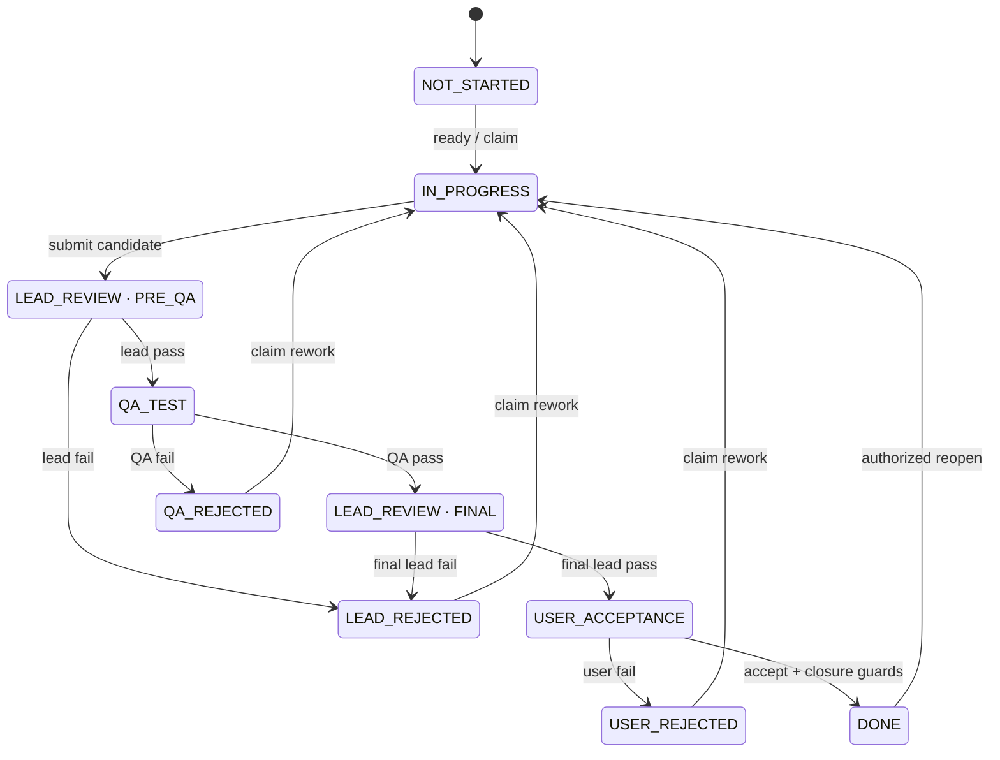

# Workflow specification 0.1

Status: proposed. This document is the canonical state, permission, approval, and completion contract. It implements the requirements in [product-spec.md](product-spec.md); D03–D07 remain reviewable policy choices.

## 1. Separate four kinds of state

| Dimension | Values / meaning |
| --- | --- |
| Issue lifecycle | Work and review progress; listed below |
| Design revision | `DRAFT`, `IN_REVIEW`, `APPROVED`, `CHANGES_REQUESTED`, `SUPERSEDED` |
| Run lifecycle | `QUEUED`, `STARTING`, `RUNNING`, `STOPPING`, `SUCCEEDED`, `FAILED`, `CANCELLED`, `UNCERTAIN` |
| Evidence/approval validity | Current, superseded, incomplete, unavailable, or invalidated at a recorded revision |

A draft issue is still `NOT_STARTED`. A running process does not prove an issue is `IN_PROGRESS`, and a successful process does not prove the issue is implemented. An issue in `QA_TEST` can have a queued QA run. Keep those facts visible without adding dozens of issue states.

## 2. Issue states

| Code | Display meaning | Additional data |
| --- | --- | --- |
| `NOT_STARTED` | Not started | May be unassigned, unscheduled, and waiting for design approval |
| `IN_PROGRESS` | Development in progress | Current assignment, run binding, lease/fence, and approved scope revision |
| `LEAD_REVIEW` | Main/product agent review | `review_stage` is required: `PRE_QA` or `FINAL` |
| `LEAD_REJECTED` | Rejected by main/product agent | Required rejection record, stage, failed criteria, and responsible assignment |
| `QA_TEST` | Independent QA | Required candidate snapshot and QA assignment/request |
| `QA_REJECTED` | Tests failed | Required QA report and blocking defect/failure references |
| `USER_ACCEPTANCE` | User acceptance | Final lead report and exact delivery snapshot |
| `USER_REJECTED` | User requested rework | Required user decision and failed criteria or clarification |
| `ON_HOLD` | Suspended | Reason, authorizing decision, previous state/stage, affected runs, optional review date |
| `ABANDONED` | Abandoned | Terminal non-delivery outcome; reason, authorization, and scope disposition |
| `DONE` | Implemented and closed | Terminal successful delivery; current approvals, evidence, and closure event |

Do not introduce a second `CLOSED` state that bypasses `DONE` validation. Abandoned is terminal for queueing but never means delivered. Merge and deployment are separate recorded facts.



Hold, resume, abandon, and scope-amendment transitions are defined separately below; they apply across several states and are intentionally omitted from the main diagram.

## 3. Transition contract

All mutations require authenticated actor scope, `expected_version`, and an idempotency key. Every successful transition appends an event in the same database transaction as the issue update. UI, MCP, runners, and later connectors use this contract without bypass routes.

| From | Action / actor | To | Required guards and evidence |
| --- | --- | --- | --- |
| No item | Create / human, lead, PM | `NOT_STARTED` | Valid workspace and parent; generated ID/key; never caller-selected active state |
| `NOT_STARTED` | Claim / assigned worker | `IN_PROGRESS` | Approved design, acknowledged task scope/criteria revision, readiness, dependencies, binding, capacity, no hold; atomic lease |
| `IN_PROGRESS` | Submit / owning worker | `LEAD_REVIEW:PRE_QA` | Current lease fence, exact candidate snapshot, criterion map, self-check evidence, handoff summary |
| `LEAD_REVIEW:PRE_QA` | Pass / assigned lead | `QA_TEST` | Current criterion-level initial review; independent QA assignment created or queued |
| `LEAD_REVIEW:PRE_QA` | Fail / assigned lead | `LEAD_REJECTED` | Reproducible rejection reasons and failed/missing criteria |
| `QA_TEST` | Pass / assigned QA | `LEAD_REVIEW:FINAL` | Independent run/session, exact candidate, complete required tests, no unresolved blocking findings |
| `QA_TEST` | Fail / assigned QA | `QA_REJECTED` | Failure report with expected/actual behavior, reproduction, severity, criterion, and artifact |
| `LEAD_REVIEW:FINAL` | Pass / assigned lead | `USER_ACCEPTANCE` | Initial review + QA still current; requirement fit and integration implications assessed |
| `LEAD_REVIEW:FINAL` | Fail / assigned lead | `LEAD_REJECTED` | Recorded final-stage rejection; rework owner retained or explicitly reassigned |
| `USER_ACCEPTANCE` | Reject / human | `USER_REJECTED` | Exact snapshot/revision and actionable feedback; classify defect vs requested scope change |
| `USER_ACCEPTANCE` | Accept / human | `DONE` when guards pass | Human decision bound to current acceptance digest; all closure checks pass |
| `USER_ACCEPTANCE` | Complete / lead or PM | `DONE` | Exact-snapshot human close grant or prior current human acceptance; all closure checks still pass |
| Any rework state | Claim rework / assigned worker | `IN_PROGRESS` | Valid assignment/binding, dependencies, fresh lease, required approved scope |
| Nonterminal state | Hold / human or granted lead/PM | `ON_HOLD` | Reason, action scope, prior state/stage saved; cancellation/reconciliation of active runs requested |
| `ON_HOLD` | Resume / human or granted lead/PM | Saved valid state or `IN_PROGRESS` | Revalidate revision, evidence, dependencies, and ownership; never restore an expired lease |
| Nonterminal state | Abandon / human or granted lead/PM | `ABANDONED` | Reason, authority, explicit child disposition and scope impact; stop/reconcile live work |
| `DONE` or `ABANDONED` | Reopen / human or specifically granted lead/PM | `IN_PROGRESS` or `NOT_STARTED` | Reason, affected parent reopened atomically, prior closure preserved, invalidated approvals identified |

On reopen, use `IN_PROGRESS` only when a ready assignment is actually claimed. Otherwise use `NOT_STARTED` and require a normal claim. If an issue returns from a review stage for implementation changes, its next submission always starts at `PRE_QA`.

Human acceptance is an immutable decision record. If the human accepts while Git verification is unavailable, preserve that decision but leave the issue in `USER_ACCEPTANCE` with `CLOSURE_BLOCKED`. A later retry may close the unchanged snapshot without asking the user again. Never display `DONE` until the closure transaction succeeds.

## 4. Permission model

| Capability | Human | Product lead | PM | Worker | QA |
| --- | --- | --- | --- | --- | --- |
| Read authorized workspace records | Yes | Yes | Yes | Assigned scope | Assigned review scope |
| Create parent / task drafts | Yes | Yes | Yes | Propose only | Defect proposal/report |
| Edit unapproved designs | Yes | Owned design | Draft decomposition | Propose changes | Propose changes |
| Approve design or material scope change | Yes | No | No | No | No |
| Plan tasks, dependencies, dates, assignees | Yes | Yes | Yes | No | No |
| Dispatch implementation | Approved policy | Coordinate | Yes | No | No |
| Claim / submit implementation | Through worker assignment | Only if separately assigned worker | Only if separately assigned worker | Own assignment | No |
| Initial / final lead review | Can perform explicitly as reviewer | Assigned reviewer | No | No | No |
| QA report and pass/fail | Separate reviewer context | No self-QA | No | No self-QA | Assigned independent review |
| User acceptance | Yes | Exact human grant only | Exact human grant only | No | No |
| Hold / abandon / exceptional close / reopen | Yes, subject to invariants | Scoped human grant | Scoped human grant | No | No |

Human manual entry does not bypass the independent QA or evidence requirements. A person may deliberately assume the QA role, with a separate reviewer record; the result must be labeled human QA rather than attributed to an agent.

Roles are resolved from a server-issued credential/actor binding. Supplying `role: "user"` or a different actor ID in tool arguments never elevates a caller. The MCP agent surface exposes request-for-approval, not human decision or grant creation.

A lead reviewer cannot approve implementation produced by that same execution identity. If the product lead also implements a task, assign a different lead-review execution identity for that task. This is separate from the additional worker/QA independence rule.

## 5. Approval and authorization records

Design approval binds `workspace_id`, `requirement_id`, `design_revision_id`, `content_hash`, human identity, decision, timestamp, and optional explanation. Task execution references that approved revision and its own reviewed scope revision.

Delivery acceptance binds an acceptance digest containing the design revision, task scope revision, artifact manifest hash, lead-review IDs, QA report ID, and verification-policy version. The UI shows those components before the human decides. An old decision is not reusable against a new digest.

A delegation grant contains the granting human, grantee, workspace/item scope, allowed action, exact revision/snapshot where relevant, expiry, maximum uses, and revocation state. Grant use is transactional and audited. A lead/PM cannot delegate beyond its grant. A generic role assignment is not an abandonment, hold, reopen, or closure grant.

For MVP, human decisions/grants originate in the authenticated web approval flow. A host adapter may later accept direct human events only after AC14 proves attribution; a model's statement that the user agreed is never such an event. Batch decisions enumerate exact item versions/digests; no hidden approval of unseen items is allowed.

## 6. Revision changes and rework

1. Requirement scope/acceptance edits create a new design revision. The approved old revision remains in history.
2. A material revision enters review, blocks new affected claims, and requests active affected runs to stop or reconcile. Unaffected completed requirements stay intact.
3. Existing task mappings, approvals, and reports remain readable but are marked stale where affected. PM proposes revised task coverage.
4. A worker replaces a candidate by opening a new implementation round. Initial review, QA, final review, and human acceptance for the old candidate cannot authorize the new one.
5. Metadata-only edits such as schedule or assignee display corrections do not invalidate artifact approval. The service categorizes allowed metadata fields; callers cannot assert that a scope edit is metadata.

An unrelated commit elsewhere in the repository does not rewrite a historical delivery record. Evidence invalidation follows changed issue submissions/scope and explicit impact analysis. Parent integration tests check the assembled result at its current integration snapshot.

## 7. Defects and QA independence

The worker's self-test is useful evidence, but cannot satisfy independent QA. A QA assignment has a different execution/session ID, QA-scoped credential, clean worktree or immutable artifact, approved requirement, and relevant implementation evidence. It does not inherit the worker's full reasoning transcript by default.

QA derives checks from acceptance criteria, tests negative/boundary behavior where relevant, and records `PASS`, `FAIL`, `BLOCKED`, or `NOT_RUN` for every required criterion/check. Blocked and not-run are not passes. A trusted runner records command, exit status, timestamps, environment/snapshot, and report artifact hashes; the QA conclusion adds interpretation.

Blocking findings create linked defects with reproduction steps, expected/actual behavior, criterion IDs, severity, and owner. Severity codes: `BLOCKER`, `MAJOR`, `MINOR`, `INFO`. Unresolved BLOCKER/MAJOR findings block QA pass. Accepting a MINOR residual risk requires an explicit human waiver attached to that delivery digest. Waivers cannot excuse untested mandatory criteria or missing human design approval.

Rework may stay within the original task; a related defect is a tracking record, not permission to ignore the task's acceptance criteria. A changed requirement goes through scope approval. Reject loops keep round numbers and reports so repeated failures are visible.

### Local execution protocol, 2026-11-06

Implementation refinement for FR11/FR12 and AC11/12/19/20/23: managed submission seals a complete delivery after the producer stops successfully. For Git, the manifest includes existing tracked files, nonignored untracked files, and explicitly submitted paths within the registered workspace root. Deleted files are absent. For non-Git delivery, regular source files are captured recursively. `.git`, dependency/service directories, `.qa`, environment files, symlinks, and submodules cannot be delivery artifacts. The private snapshot stores content hashes, sizes, and Git modes and is revalidated before review and acceptance. The copy, rather than a producer's later edits, is the reviewed delivery. Snapshot limits are configurable; large-workspace performance is still unverified.

The human creates an immutable check profile with an absolute native executable, fixed arguments, timeout, and covered criteria. Lead/PM selects an independent QA actor, harness, and approved profiles. Initial lead pass queues QA when configured; otherwise the issue waits at `QA_TEST`. Every QA run gets a new scoped credential/session and a separate snapshot copy, approved design, and handoff summary. No worker transcript is passed.

QA authors tests under `.qa`, queues `qa_check_run`, reads `qa_check_get`, and submits `qa_report_submit` with all criteria, captured check IDs, and reproducible findings. The service, not the model's shell-output claim, records process metadata, command/arguments, exit code, bounded output, timestamps, test-source hashes, and candidate/snapshot identity. Check processes receive a minimal environment without service/provider tokens. This is trusted local test execution under the same OS user, not hostile-code isolation.

The report cannot advance the issue until the native QA producer has stopped successfully and the evidence is revalidated. `PASS` advances to final lead review; `FAIL` creates assigned defects and enters `QA_REJECTED`; `BLOCKED` or `NOT_RUN` cannot pass. A fresh successful QA round resolves prior open defects for the same task, retaining the old reports and failure evidence. Narrative `review_submit` cannot pass or fail the QA gate. Lost check execution stays uncertain and consumes check capacity until explicit recovery; recorded live test PIDs block operator reconciliation.

Final lead pass exposes an exact delivery digest. Human `delivery_decide` can accept/reject only that digest. Reviewed artifact mode can close after all guards; Git mode retains acceptance with closure blocked until remote commit verification matches that snapshot. These commands refine the existing gates and do not waive Git, parent integration, UI/human attribution, minor-risk waiver, or release acceptance requirements. The present implementation is stricter than the target waiver policy: any non-INFO current QA finding prevents a pass.

## 8. Hold, abandon, and interrupted execution

Hold and abandon are business decisions. A failed process, provider limit, lost heartbeat, or unknown execution creates a run problem and a gap; it does not automatically abandon or human-authorize suspension of the issue.

An effective ancestor hold blocks new descendant claims/dispatches immediately. Descendant states are preserved; active descendant runs receive stop requests. `STOPPING`/`UNCERTAIN` remain visible until confirmed. Changing the issue status does not assert that a subprocess stopped.

Abandoning a parent requires a proposed disposition for each unresolved child: abandon with authority, retain/reparent through an approved scope amendment, or reject the parent action. No silent cascade. In-scope child abandonment makes the parent's scope unsatisfied until the user approves exclusion or replacement.

Resume reacquires execution ownership and revalidates evidence. If the saved review snapshot is unchanged and still valid, the review may resume. If implementation is required, resume to unstarted/in-progress with a fresh lease, then repeat the review pipeline.

## 9. Parent completion and reopening

Proposed strict policy (D04): all children done is necessary but does not prove integrated behavior. With children, a parent remains `IN_PROGRESS` until its integration packet is ready, then uses the same initial-lead → integration-QA → final-lead → human acceptance gates.

The first child claim changes an unstarted aggregate parent to `IN_PROGRESS` with an aggregation event; a waiting parent needs no implementation lease or worker slot. When children are done, a separately assigned integration run prepares the parent's candidate packet and uses the normal submission/review guards. An aggregate's `IN_PROGRESS` therefore means active child or integration work, not an invented worker process.

Completion predicate:

```text
parent_complete =
  approved_current_design
  AND nonempty_delivery_scope
  AND every_in_scope_child.status == DONE
  AND every_excluded_child.has_current_human_scope_decision
  AND all_parent_criteria_have_current_passing_evidence
  AND current_integration_QA_and_lead_reviews
  AND current_human_acceptance
  AND applicable_git_or_artifact_closure_evidence
```

The final successful child transition updates completion readiness in the same transaction; it does not fabricate the parent's review records. Once all parent guards are true, the service closes the parent automatically and records the causal event.

If the user prefers literal child-only auto-completion, revise D04 and the relevant acceptance tests before implementation; do not silently weaken the strict rule. A childless executable requirement follows the leaf pipeline. An empty aggregate with no delivered scope cannot complete by vacuous truth.

Adding a child to a done parent requires explicit reopen/scope approval first. Reopening a delivered child atomically reopens an affected done parent and invalidates its relevant integration acceptance. A parent cannot claim completion while an in-scope child is reopened.

Adding or changing in-scope children while a parent is already under review invalidates the affected integration packet and returns it to `IN_PROGRESS`. Child-plan changes and parent closure compare the same parent version transactionally, so a concurrent new child cannot slip behind completion validation.

## 10. Git and non-Git closure

For Git-backed work, closure requires repository identity, full final delivery commit SHA, canonical commit URL, issue-to-change mapping, and successful provider resolution of that SHA in that repository. Store verification timestamp and provenance. URLs to branches, pull requests, compare pages, or abbreviated SHAs do not replace the final commit link.

The final commit is the last submitted commit for the issue's reviewed delivery snapshot, not necessarily the repository's newest global commit. Multi-repository deliveries require a commit entry for each changed repository. A parent with no unique code diff references its integration snapshot and the child manifest instead of inventing an extra commit.

MVP Git provider: GitHub.com. Other hosts return `UNSUPPORTED_PROVIDER` until adapters exist. Local-only Git can participate in drafting/review but cannot satisfy the required clickable remote commit at `DONE`. Network outage leaves closure pending; it never records an invented verification.

Non-Git work declares its artifact mode before execution, with a human-reviewed reason and immutable document/file/test artifact hashes. Changing a Git-backed task to non-Git after work starts requires human scope approval; agents cannot use the mode change to evade commit evidence.

Completion is not a merge or deployment claim. The parent integration report explicitly names the assembled artifact/branch snapshot and any merge/release state. The plugin does not merge or deploy by virtue of closing an issue.

### Git verification protocol, 2026-11-06

Implementation refinement for FR12/FR13/FR23 and AC20-23/35: the owner binds the registered Git workspace to one explicitly selected local GitHub remote with `workspace_git_bind`. The binding records repository identity and the workspace's repository-relative directory. It does not collapse independent clones. Replacing an existing binding while approved or active Git work exists is blocked until that scope is reset; historical bindings remain readable.

Lead/PM or the owner uses `git_submit` to attach a canonical GitHub commit URL with a full 40-character SHA to a sealed candidate. Branch/PR/compare links, query strings, alternate hosts, and wrong repositories are rejected. The attachment is an issue-to-commit mapping, not verification. Changing that mapping invalidates affected human delivery acceptance, retaining all previous records. The delivery digest includes the exact attachment and binding; a retry against the same attachment does not change it.

A service-owned read job resolves the commit through the GitHub Git database API and compares the complete scoped Git tree with the sealed snapshot, including file bytes, names, deletion, directory structure, and executable modes. It records immutable attempts, API provenance, returned tree identity, and verification time. Remote verification runs outside SQLite write transactions and does not consume a model-run slot. Model/user-supplied verification claims cannot set a successful result. Incomplete provider responses fail closed. The implementation begins with exact stored bytes; checkout filters/line-ending normalization, multi-repository delivery packets, and parent manifests remain separate mandatory integration work and must not be claimed as supported by this slice.

`git_retry` requeues failed/unavailable read verification of the same target. Restarted in-flight verification becomes unavailable and requires an explicit retry; read jobs are never mistaken for agent execution. Current exact human acceptance can close automatically after successful verification; `delivery_complete` rechecks saved acceptance without inventing a new human decision. Holds, children, dependencies, live/uncertain producers, stale snapshots, and review/defect guards still apply. Network/authentication/rate-limit failures leave the issue open with a named blocker. A completed record retains its historical verification even during a later provider outage.

Provider baseline: [GitHub Git commits](https://docs.github.com/en/rest/git/commits), [Git trees](https://docs.github.com/en/rest/git/trees), and [Git object format](https://git-scm.com/book/en/v2/Git-Internals-Git-Objects). The initial API version is `2026-03-10`, verified against [GitHub's supported-version list](https://docs.github.com/en/rest/about-the-rest-api/api-versions). These references specify the implementation; they are not runtime acceptance evidence.
